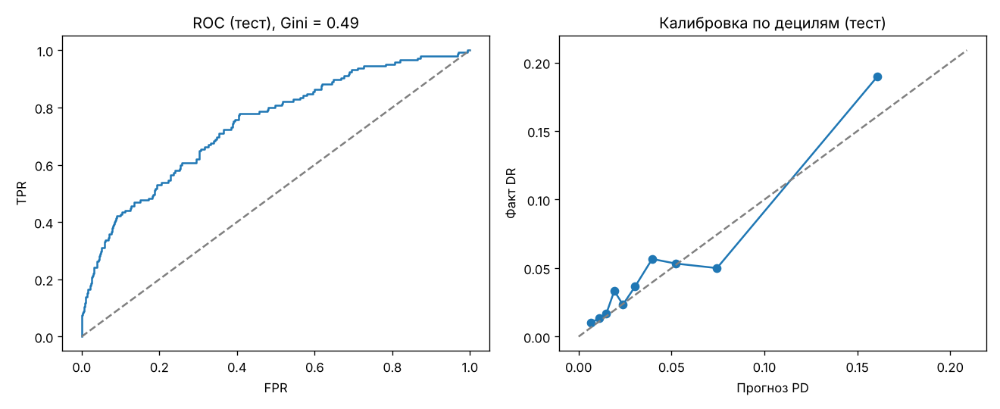
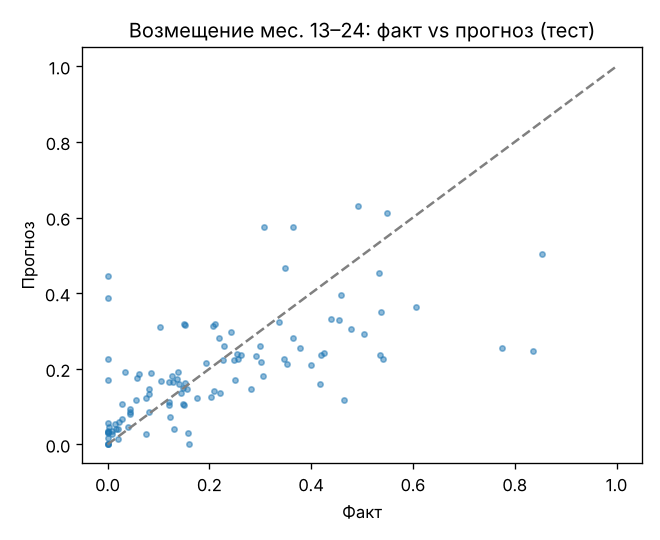
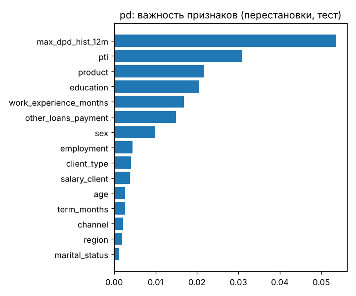

# Credit risk models on a synthetic consumer loan portfolio: PD, LGD-12, LGD-24

End-to-end example of retail credit risk modelling: a reproducible synthetic portfolio of consumer loans with monthly repayment history and post-default collections, three models (PD, LGD-12, LGD-24) and experiment tracking in **MLflow on DagsHub**.

> **All data are synthetic.** The portfolio is generated by `src/gen_portfolio.py` (fixed random seed) and does not relate to any real bank or borrower. Amounts are in BYN.

*Краткое описание на русском — в конце файла.*

---

## Contents

```
credit-risk-models/
├── data/
│   └── consumer_loans_portfolio.xlsx   # synthetic portfolio (generated, 12,000 loans)
├── src/
│   ├── gen_portfolio.py                # portfolio generator (seed = 2026)
│   ├── build_xlsx.py                   # writes the Excel file with field dictionary and summary
│   └── credit_models.py                # PD, LGD-12, LGD-24 + MLflow / DagsHub logging
├── docs/                               # charts for this README
├── requirements.txt
└── README.md
```

## Data

12,000 consumer loans issued **Jan 2023 – Dec 2024**, observed until **Oct 2026** (later vintages and defaults are right-censored, as in real data).

| Product | Channels | Interest rate | Default rate (90+ within 9 months) |
|---|---|---|---|
| POS loan | store, marketplace | 0% (instalments) or 16–22% | 4.3% |
| Credit card | branch, online | 22–30% | 3.6% |
| Cash loan, offline | branch | 14–18% | 2.6% |
| Cash loan, online | online | 18–26% | 7.9% |

Excel sheets (column names in English, descriptions and category values in Russian):

- **Займы (loans)** — borrower and loan characteristics at origination: age, sex, region, education, employment, income, credit history, payment-to-income, product, channel, amount/limit, term, rate; default flags and EAD.
- **Помесячно (monthly)** — for every loan and month on book: scheduled payment, amount paid (principal / interest), balance, total debt, **maximum days past due within the month**, status.
- **Взыскание (collection)** — for every month after default: calls, auto-dialer, SMS, right-party contacts, promises to pay, collection stage, legal stage, amount collected, legal and postage costs.
- **Описание / Сводка** — field dictionary, default rates and recovery curves.

**Definitions**

- **Default:** 90+ days past due within the first 9 months from origination (`default_9m`). Loans reaching 90+ later are also sent to collection (`default_any`).
- **Collection process:** month 1 after default — soft collection; from month 2 — legal (notary enforcement order → enforcement authority → wage garnishment / asset search).
- **Net recovery** = collected − legal costs − postage. No interest or penalties accrue after default.

Recovery curve of the whole portfolio (share of EAD): ~20% at 12 months, ~31% at 24 months, ~40% at 30 months.

## Models

| Model | Target | Features | Train / test split | Champion |
|---|---|---|---|---|
| **PD** | default 90+ within 9 months | application data | out-of-time: issued up to 2024-06 / after | logistic regression |
| **LGD-12** | 1 − net recovery months 1–12 / EAD | data at default date | out-of-time by default date (70 / 30) | ridge regression |
| **LGD-24** | net recovery months 13–24 / EAD, then LGD24 = 1 − RR₁₋₁₂ − forecast | first-year collection history | out-of-time by default date (70 / 30) | gradient boosting |

The LGD models mirror a common practice in collections: a forecast made at the default date is refined as actual collection data accumulate. Each model is compared against an alternative algorithm (logistic regression vs gradient boosting, ridge vs gradient boosting); the one with the better out-of-time result is kept.

### Results (out-of-time test)

| Model | Metrics |
|---|---|
| PD | Gini 0.49, KS 0.37, mean predicted PD 4.3% vs observed default rate 4.8%, PSI train/test 0.005 |
| LGD-12 | MAE 0.22, Spearman 0.44, EAD-weighted bias −0.4 pp |
| LGD-24 | MAE 0.10, Spearman 0.70; LGD-24 predicted 75.6% vs observed 75.3% (EAD-weighted) |

<p>
<br>
 
</p>

**Limitations.** Synthetic data; small LGD samples (651 and 346 defaults); the champion is selected on the same out-of-time sample used for reporting, so metrics are slightly optimistic. No macroeconomic adjustment, collateral or cures.

## How to run

```bash
pip install -r requirements.txt

# 1. (optional) regenerate the portfolio — gives exactly the same data thanks to the fixed seed
python src/gen_portfolio.py

# 2. train models without logging
python src/credit_models.py --no-mlflow

# 3. train and log to a local MLflow folder (./mlruns)
python src/credit_models.py --local-mlflow
```

### Logging to MLflow on DagsHub

1. Connect this GitHub repository to DagsHub (**Create → New Repository → Connect a repository**). Every DagsHub repository has its own MLflow tracking server.
2. Create a token: **Your settings → Tokens**.
3. Set environment variables (never put the token in code):

```bash
export DAGSHUB_USER=<dagshub_login>
export DAGSHUB_REPO=credit-risk-models
export DAGSHUB_TOKEN=<token>
python src/credit_models.py
```

Windows (cmd): use `set` instead of `export`.

Each model is logged as a separate run in the experiment `conditional-portfolio-credit-risk`: parameters, metrics of both candidates, charts, feature importance and the model itself (scikit-learn pipeline with preprocessing, signature and input example). Models are registered in the Model Registry as `pd_model`, `lgd12_model`, `lgd24_model` (disable with `--no-register`).

Requires MLflow ≥ 3.1 (DagsHub supports MLflow 3.x).

---

## Кратко на русском

Учебный проект по кредитному риску на **синтетическом** портфеле потребкредитов (POS, карты, наличные онлайн и офлайн; 12 000 займов). Есть помесячная история платежей с максимальной просрочкой и помесячное взыскание после дефолта (софт → лигал). Построены модели **PD** (дефолт 90+ в первые 9 месяцев), **LGD-12** (на дату дефолта) и **LGD-24** (на 12-й месяц после дефолта, по данным первого года взыскания). Модели логируются в **MLflow на DagsHub**. Данные полностью условные и не относятся ни к одному банку.

## Author

Iulia Kogoleva — [github.com/IuliaKogoleva](https://github.com/IuliaKogoleva)
